# Fully AI Powered Yacht Video Production (YVP) Systems
### A State-of-the-Art Framework for AI-Driven Cinematic Superyacht Filmmaking

[](standards/sota/)
[](productions/YVP-ORIGINAL-001/)
[](productions/YVP-ORIGINAL-001/qa/G1-closure-record-001.md)
[](productions/YVP-ORIGINAL-001/brief/production-readiness.md)

---

## 1. Cinematic Video Showcase — The Opening Experience

The **Yacht Video Production (YVP)** framework is an end-to-end creative and technical discipline engineered to produce broadcast-grade, identity-faithful cinematic films of luxury motor yachts using controlled generative artificial intelligence.

At the center of the production is a precisely timed, ten-second screening presentation: **AURELIA 42 — The Mediterranean Screening**.

---

## Watch the Final Pilot Video

Experience the complete, assembled screening presentation of **AURELIA 42** conformed at 24 fps CFR:

[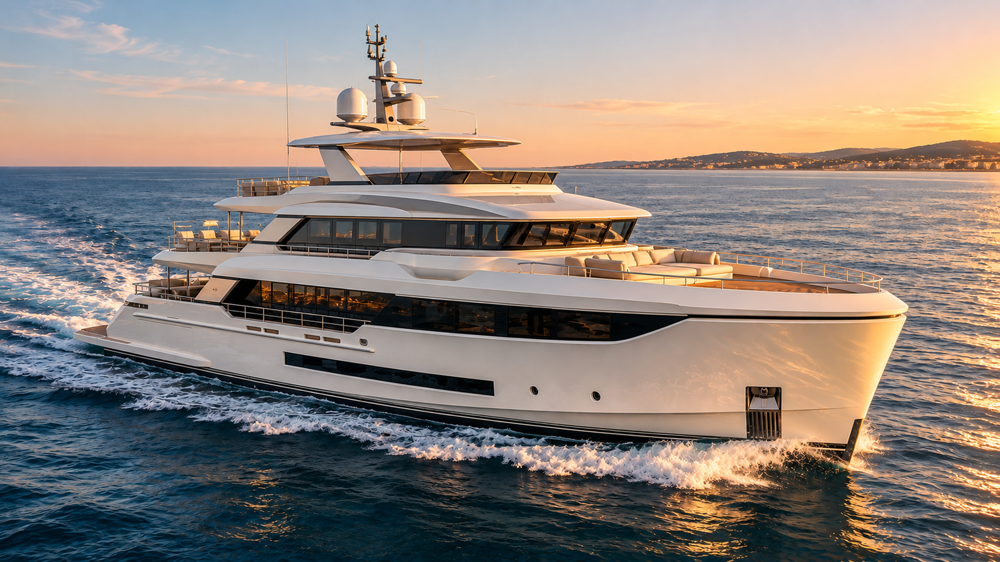](productions/YVP-ORIGINAL-001/deliverables/YVP-ORIGINAL-001-final-capcut.mp4)

▶ **[Watch the Final Pilot Video (MP4)](productions/YVP-ORIGINAL-001/deliverables/YVP-ORIGINAL-001-final-capcut.mp4)**  
*Delivery file: `productions/YVP-ORIGINAL-001/deliverables/YVP-ORIGINAL-001-final-capcut.mp4` (71.6 MB, 1080p, 24 fps CFR)*


```text
┌────────────────────────────────────────────────────────────────────────────────────────┐
│                                                                                        │
│                                  CINEMATIC MASTER FILM                                 │
│                                                                                        │
│                                      AURELIA 42                                        │
│                           A Mediterranean Cinematic Journey                            │
│                                                                                        │
│                       [ 10.0 Seconds · 240 Frames · 24.00 FPS ]                        │
│                                                                                        │
└────────────────────────────────────────────────────────────────────────────────────────┘
```

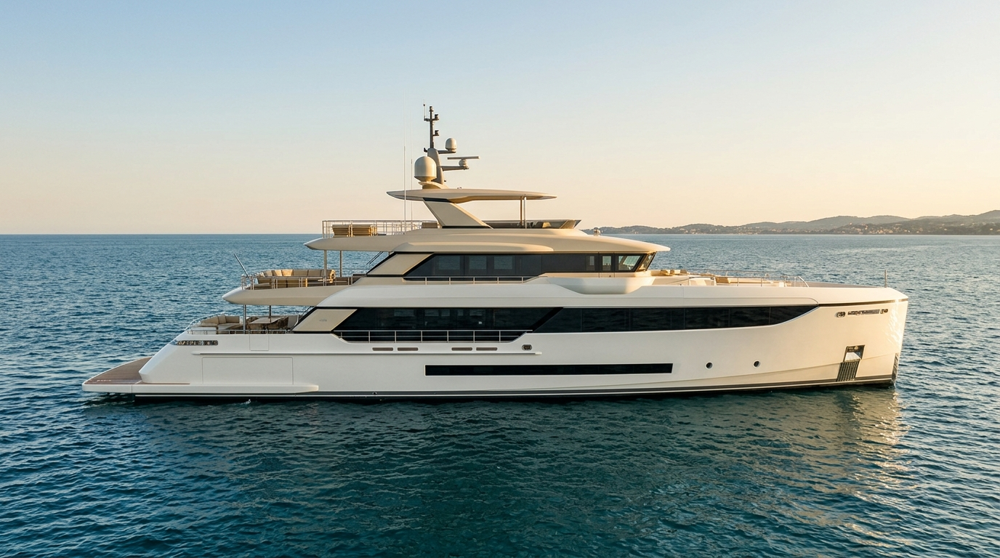

> [!NOTE]
> **Production Status Preview:**  
> The master film presentation is currently in active staged production. **Gate G1 (Vessel Identity Approval)** has been formally reviewed and **`CLOSED_APPROVED`**, locking the complete six-master visual identity baseline. Downstream animation keyframe preparation (**Gate G2**) and video synthesis (**Gates G3–G5**) are currently in planning. The visual preview above displays the canonical Full Starboard Profile Identity Master (`IM-02_master.png`), establishing the authoritative exterior architecture, Mediterranean golden-hour lighting, and material identity of the vessel.

### Master Film Specifications

| Parameter | Master Delivery Contract | Description / Artistic Intent |
|---|:---:|---|
| **Film Title** | *AURELIA 42 — Presence, Invitation, Experience* | Original contemporary luxury superyacht commercial film |
| **Sequence Runtime** | **`10.000 Seconds`** | Concise, high-impact luxury brokerage screening sequence |
| **Total Frame Count** | **`240 Frames`** | Exactly 240 frames at constant frame rate (CFR) |
| **Frame Rate** | **`24.00 FPS`** | Cinematic standard shutter cadence (`1/48s` equivalent motion blur) |
| **Resolution & Format** | **`1920 × 1080`** (or `3840 × 2160`) | 16:9 widescreen landscape (`DAR 16:9`, `SAR 1:1`) |
| **Color Standard** | **`Rec.709 / sRGB`** | Professional broadcast gamut with balanced luxury tonal contrast |
| **Audio Treatment** | **`Silent Master`** | Pure visual screening master conforming to international yacht presentation standards |
| **Cuts & Scenes** | **`6 Setups · 5 Motivated Cuts`** | Seamless continuous choreography without AI camera jumps or frame morphs |

---

## 2. Vessel Identity — Approved Master Image Gallery

In generative AI filmmaking, unconstrained image generators suffer from severe structural drift: hulls warp between cuts, window ribbons shift elevations, deck staircases appear and vanish, and interior materials fail to match exterior viewpoints.

The YVP system solves this through an uncompromising **Identity Master Suite**. Before a single keyframe or video clip is animated, the complete three-dimensional vessel is captured across six canonical camera perspectives. Once approved by the Human Creative Director, these images serve as **immutable conditioning anchors** for the entire production pipeline.

The subject of our inaugural pilot is **AURELIA 42**, a 42-meter original contemporary semi-displacement motor superyacht designed with an 8.2-meter beam, three stepped superstructure tiers, a sculptural reverse-angle bow, and seamless indoor-outdoor transitions.

---

### IM-01 · Bow Hero Identity Master
**Scene Zone:** Forward Quarter & Bow Flare · **Governing Camera:** `CAM-01` (Frames 0–27)

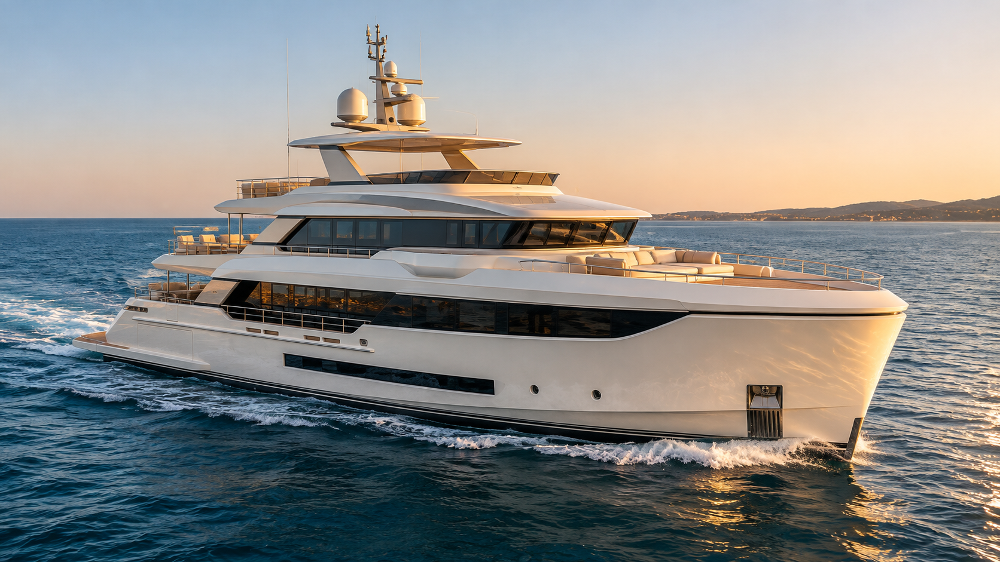

The opening statement of the film. Captured from an elevated forward-starboard three-quarter angle, this master establishes the vessel's sculptural naval architecture: the knife-edge reverse plumb stem, refined bow flare, smooth sheer line, gloss ivory-white hull (`#F2F0E9`), and warm ivory superstructure (`#E8E2D6`). Dark graphite panoramic glazing bands (`#252C33`) wrap smoothly around the deckhouse, while dual satellite domes cap the low-profile radar mast. The hull meets calm Mediterranean sea with realistic hydrodynamic displacement and subtle spray.

---

### IM-02 · Full Profile Identity Master
**Scene Zone:** Starboard Broadside · **Governing Camera:** `CAM-02` (Frames 28–61)


The architectural blueprint of AURELIA 42. Captured perpendicular to the vessel's centerline at a focal length equivalent to 85mm, this master defines the complete 42-meter silhouette. It fixes the three principal deck tiers: Main Deck ($Z = +2.7\text{m}$), Upper Bridge Deck ($Z = +5.8\text{m}$), and Sun Deck canopy ($Z = +8.8\text{m}$), topped by the mast apex ($Z = +13.0\text{m}$). The master anchors the continuous main-deck window band, the dark waterline boot stripe, the open aft terrace hierarchy, and the single starboard-side exterior staircase.

---

### IM-03 · Stern Reveal Identity Master
**Scene Zone:** Transom Cascade & Aft Overview · **Governing Camera:** `CAM-03` (Frames 62–95)

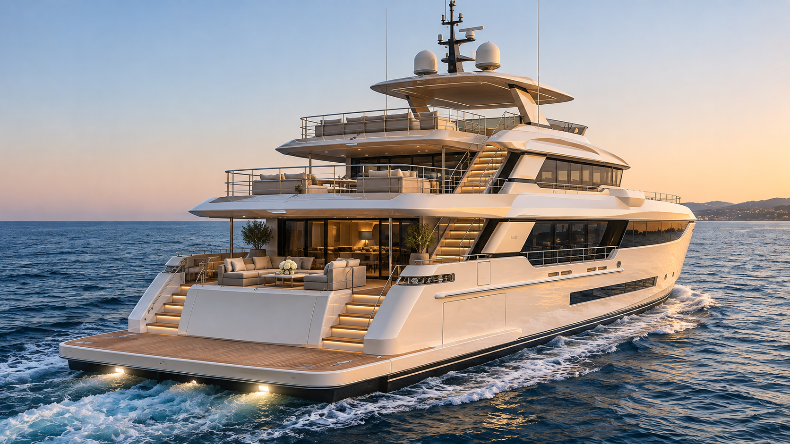

The transition from seaward power to architectural luxury. Positioned off the aft-starboard quarter, this master reveals the yacht's generous 8.2-meter beam and stepped cascade stern. Symmetrical curved teak stairways flank the central transom, descending smoothly to an integrated full-beam teak swim platform resting just above static waterline ($Z = 0.0$). Stainless-steel capped smoked glass balustrades frame the aft entertaining terraces, while golden-hour sunlight reflects naturally across the twin transom garage seams and Mediterranean sea surface.

---

### IM-04 · Aft Terrace Identity Master
**Scene Zone:** Main Deck Entertaining Cockpit · **Governing Camera:** `CAM-04` (Frames 96–131)

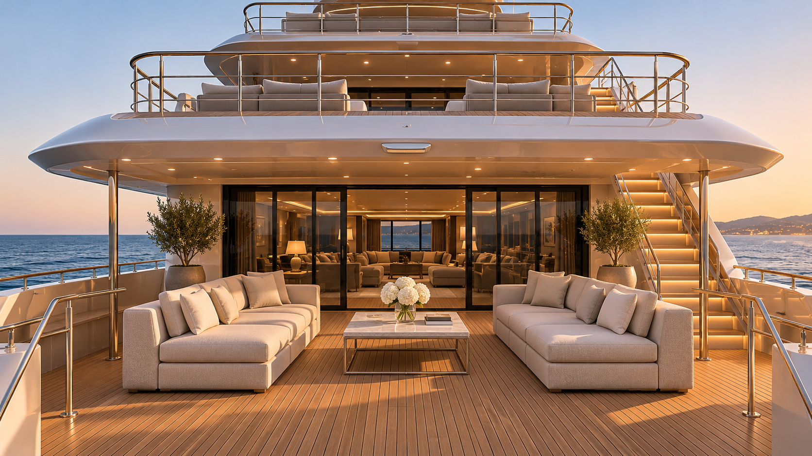

The invitation aboard. Looking forward from the aft deck along the vessel centerline, this master reveals tactile materiality and lifestyle architecture. Golden teak planking runs fore-and-aft with crisp black caulking seams. Low-profile modular lounge seating upholstered in weather-resistant cream bouclé (`#DED6C7`) with satin champagne metal accents (`#C3AD8C`) brackets a generous central circulation corridor ($Y = 0.0$). To starboard, the asymmetric exterior staircase leads gracefully to the bridge deck, while floor-to-ceiling sliding glass doors frame the saloon entrance ahead.

---

### IM-05 · Main Saloon Threshold Identity Master
**Scene Zone:** Cockpit-to-Saloon Portal · **Governing Camera:** `CAM-05` (Frames 132–167)

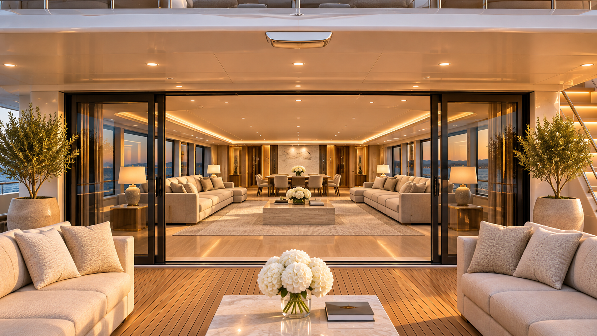

The spatial and optical bridge connecting exterior marine elements to interior living spaces. Positioned at eye level just outside the opened full-height dark graphite sliding door frame ($X \approx +8.2\text{m}$), this master captures the harmonious balance between warm low-angle exterior sunlight and the soft, recessed ~2700K architectural LED cove lighting inside the saloon. The minimal door threshold creates an unbroken plane between the weathered exterior teak and the pale European oak interior flooring.

---

### IM-06 · Main Saloon Living Identity Master
**Scene Zone:** Interior Saloon & Dining · **Governing Camera:** `CAM-06` (Frames 168–239)

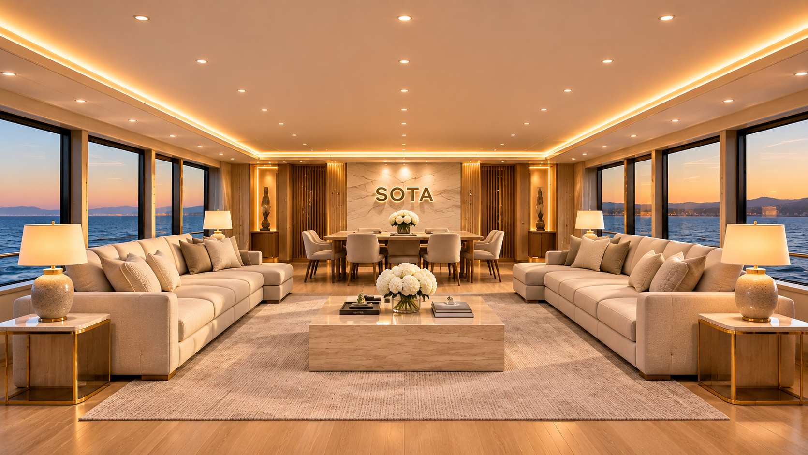

The emotional climax and final destination of the film. Positioned inside the saloon ($X \approx +11.5\text{m}$, $Y = 0.0$) looking forward, this master establishes the full interior luxury environment. Bilateral low-profile cream bouclé modular sofas face twin honed travertine coffee tables across an open walking aisle. Full-height panoramic side windows flood the room with natural light while preserving ocean horizons. Fluted European oak wall panels transition into a forward formal dining suite, centered on an architectural feature wall integrating the human-authorized brushed champagne-metal **SOTA** wordmark.

---

## 3. The Story — Cinematic Vision and Inspiration

Luxury yacht cinema is not merely product documentation; it is an orchestrated journey of discovery. The YVP framework abandons disjointed promotional sizzle reels in favor of a timeless, three-act visual narrative: **Presence → Invitation → Experience**.

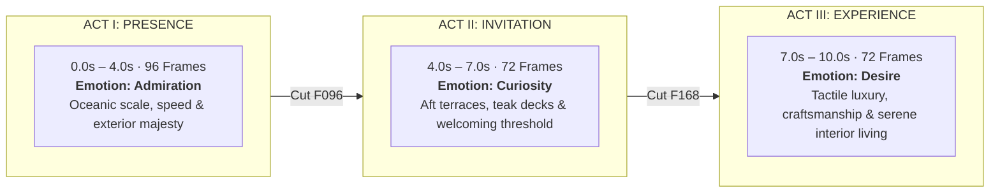

### The Narrative Arc

- **Act I — Presence (`0.0s – 4.0s` / 96 Frames):**  
  The film opens on open Mediterranean waters during the late-afternoon golden hour. Sun sits low at approximately 18 degrees above the horizon, casting warm, natural highlights across the gloss ivory hull. The viewer admires AURELIA 42 from the air: her purposeful forward tracking, confident reverse bow, and tiered cascade profile as she cruises at an effortless 14 knots.

- **Act II — Invitation (`4.0s – 7.0s` / 72 Frames):**  
  The camera transitions from admiring observer to arriving guest. Descending toward the stern, we discover the lifestyle awaiting aboard: wide teak steps rising from the water, generous sunbeds, sheltered dining, and the welcoming open portal of the main saloon. The yacht ceases to be a distant sculpture and becomes a private sanctuary.

- **Act III — Experience (`7.0s – 10.0s` / 72 Frames):**  
  Crossing the threshold, the viewer steps inside. The final three seconds linger in the quiet luxury of the main saloon. Surrounded by pale oak, natural stone, and soft bouclé textiles, the camera pushes gently forward as cove lighting harmonizes with golden sea reflections through panoramic glass. The film concludes on an enduring impression of sophistication and peace.

---

## 4. Director's Script — Translating Story into Cinematic Shots

Every camera movement, lens choice, and cut in the YVP framework is governed by the canonical **Professional Six-Camera Director's Script** (`standards/sota/directors-script.md`). 

The film utilizes six continuous setups connected by five motivated match cuts. There are no sudden angle jumps or synthetic AI teleports *within* a take; camera physics adhere strictly to real gyro-stabilized aerial tracking gimbals and motorized interior dollies.

```text
0.0s                      4.0s                  7.0s                 10.0s
│────── ACT I: PRESENCE ──│── ACT II: INVITE ───│── ACT III: EXPERIENCE ─│
│  CAM-01   CAM-02   CAM-03│  CAM-04   CAM-05    │        CAM-06          │
│   28f      34f      34f  │   36f      36f      │         72f            │
└─────────▲────────▲───────┴────────▲────────▲───┴──────────▲────────────┘
         Cut 1    Cut 2            Cut 3    Cut 4          Cut 5
         (F028)   (F062)           (F096)   (F132)         (F168)
```

### The Six Camera Sequences

| Setup | Frames | Duration | Lens | Camera Motion & Trajectory | Visual Story & Focus |
|---|:---:|:---:|:---:|---|---|
| **CAM-01<br/>The Hero Arrival** | `0–27` | `1.17s`<br/>(28f) | `35mm` | Elevated forward-quarter diagonal tracking with restrained dolly-in and subtle lateral arc. | Hero bow flare, stem geometry, sheer line, and forward superstructure reveal. |
| **CAM-02<br/>Signature Profile** | `28–61` | `1.42s`<br/>(34f) | `85mm` | Elevated starboard-beam parallel tracking with subtle gimbal pan matching vessel cruising speed. | Complete 42m profile, three deck tiers, window bands, boot stripe, and true naval proportions. |
| **CAM-03<br/>Architectural Reveal** | `62–95` | `1.42s`<br/>(34f) | `40mm` | Aft-quarter shallow orbital arc combined with gentle crane-up and tilt-down. | Stern geometry, dual transom stairs, teak swim platform, and tiered aft terrace cascade. |
| **CAM-04<br/>The Invitation** | `96–131` | `1.50s`<br/>(36f) | `32mm` | Closer aft-deck descending dolly-in tracking forward along deck level. | Aft cockpit lounge, dining layout, teak deck caulking, railings, and starboard stair. |
| **CAM-05<br/>The Threshold** | `132–167` | `1.50s`<br/>(36f) | `28mm` | Controlled eye-level forward dolly toward and across the sliding glass saloon entrance. | Spatial portal between exterior and interior; light balance between sun and warm LEDs. |
| **CAM-06<br/>Interior Experience** | `168–239` | `3.00s`<br/>(72f) | `28mm` | Smooth, slow rectilinear dolly forward along vessel centerline ($Y = 0.0$). | Full main saloon interior: modular sofas, oak paneling, ocean views, and forward feature wall. |

### The Five Motivated Match Cuts

1. **Cut 1 (Frame 28 · Bow to Profile):** Matched forward travel vector, vessel waterline scale, and sun angle.
2. **Cut 2 (Frame 62 · Profile to Stern):** Matched superstructure datum height and motion speed as camera wraps around the stern.
3. **Cut 3 (Frame 96 · Exterior Ocean to Aft Deck):** Perspective transition from exterior aerial tracking to intimate deck level.
4. **Cut 4 (Frame 132 · Terrace to Cockpit Threshold):** Matched forward travel axis directly aligned with the saloon doorway.
5. **Cut 5 (Frame 168 · Threshold to Living Interior):** Unbroken spatial match across the doorway plane into the main living sanctuary.

---

## 5. AI Visual Production — Controlled Creative Workflow

Generative video models produce photorealistic results only when provided with rigorous structural constraints. The YVP framework implements a multi-stage conditioning methodology that treats AI as a precision rendering engine guided by human creative direction.

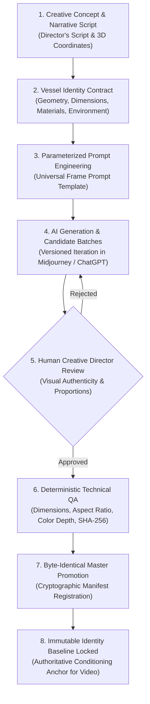

### Key Principles of Controlled AI Production

- **Human Direction as Final Authority:**  
  Generative models propose; human directors decide. Automated scripts verify pixel dimensions, compression integrity, and file checksums, but only human creative judgment can evaluate naval elegance, visual balance, and emotional resonance. (For example, during `IM-06` production, Candidate 001 was rejected for repeating the exterior threshold view, leading directly to the approved, fully immersive Candidate 002).

- **Staged Reference Conditioning:**  
  Images are never rendered in isolation. The full profile master (`IM-02`) conditions the bow (`IM-01`) and stern (`IM-03`). The stern conditions the aft deck (`IM-04`). The aft deck conditions the threshold (`IM-05`), which in turn anchors the interior saloon (`IM-06`). Each asset is mathematically and visually parented by verified upstream masters.

- **Universal Frame Prompt Architecture:**  
  Prompts are built using structured engineering templates (`templates/prompts/sota-universal-frame-prompt-template.md`) that standardize vessel geometry, lens physics, photographic exposure, atmospheric environment, and negative constraint modules across all prompts.

- **Cryptographic Provenance:**  
  Every promoted master is copied byte-identically into repository storage, and its SHA-256 hash is permanently registered in `assets/asset-manifest.json`.

---

## 6. Cinematic Production Pipeline

The transition from static identity masters to a finished 240-frame master film follows five strict, stage-gated lifecycle quality gates established in `standards/sota/identity-and-antidrift-controls.md`.

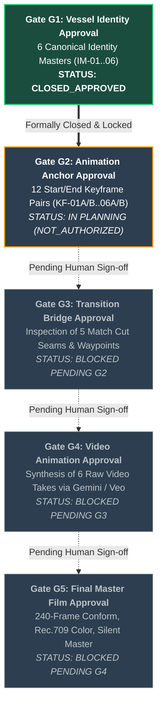

### Lifecycle Gate Overview

1. **Gate G1 — Vessel Identity Approval (`CLOSED_APPROVED`):**  
   *Current Milestone.* All six canonical Identity Masters (`IM-01` through `IM-06`) are generated, approved by the Human Creative Director, verified for cross-master continuity, and locked as the immutable visual baseline.

2. **Gate G2 — Animation Anchor Approval (`IN PLANNING / NOT_AUTHORIZED`):**  
   Derives the twelve Video Animation Keyframe Anchors (`KF-01A/B` through `KF-06A/B`) representing the exact opening and closing frames for each camera setup. Enforces full $1920\times 1080$ minimum resolution and strict alignment with the director's script.

3. **Gate G3 — Transition Bridge Approval (`PLANNED`):**  
   Validates continuity across the five editorial cut seams (e.g. `KF-01B` $\leftrightarrow$ `KF-02A`). Confirms that vessel scale, velocity vectors, water contact, and lighting angles match seamlessly across cuts. Deploys optional waypoints (`WP-01`..`06`) if complex motion requires intermediate guidance.

4. **Gate G4 — Video Animation Approval (`PLANNED`):**  
   Synthesizes the six raw continuous video takes using state-of-the-art Image-to-Video (I2V) conditioning engines (such as Google Gemini / Veo). Each take is conditioned on its approved keyframe anchor pair, guaranteeing stable hulls, consistent windows, and natural hydrodynamic wake.

5. **Gate G5 — Final Master Film Approval (`PLANNED`):**  
   Conforms the six raw takes into the final 240-frame master edit. Executes straight cuts on exact frames (28, 62, 96, 132, 168), verifies Rec.709 color consistency, ensures zero audio streams in container, and completes final broadcast QA.

---

## 7. Technical System Overview — Architecture & Repository Structure

The Yacht Video Production repository is structured as a production-hardened monorepo combining creative standards, automated intake pipelines, prompt libraries, cryptographic asset registers, and isolated production workspaces.

```text
Yacht-AI-Video-Production/
├── standards/
│   └── sota/                                # Canonical creative & directorial standards
│       ├── README.md                        # Master standard framework index
│       ├── universal-story-framework.md     # 10s / 240f / 3-act narrative standard
│       ├── directors-script.md              # 6-camera choreography & 3D coordinates
│       ├── 24-image-production-map.md       # Comprehensive 24-image production plan
│       ├── identity-and-antidrift-controls.md # Anti-drift rules & lifecycle quality gates
│       └── video-platform-handoff.md        # Video generator conditioning & QA protocols
│
├── productions/
│   ├── YVP-ORIGINAL-001/                    # Active Pilot: AURELIA 42 (AI Superyacht)
│   │   ├── brief/
│   │   │   ├── vessel-identity-lock.md      # Locked AURELIA 42 architectural contract
│   │   │   ├── image-production-register.md # Status of all planned production images
│   │   │   ├── production-readiness.md      # Gate checklists & readiness tracking
│   │   │   └── identity-masters/            # Individual specifications IM-01 through IM-06
│   │   ├── assets/
│   │   │   ├── asset-manifest.json          # Cryptographic SHA-256 provenance manifest
│   │   │   ├── approved/identity/           # Canonical master files (IM-01..06_master.png)
│   │   │   └── candidates/identity/         # Versioned candidate history (cand_001, etc.)
│   │   ├── prompts/
│   │   │   └── images/                      # Versioned prompt specifications
│   │   └── qa/                              # Evaluation reports & formal closure records
│   │
│   └── YACHT-001/                           # Pilot: Authenticated Commercial Yacht
│       └── ...                              # (Reserved for licensed commercial productions)
│
├── templates/
│   ├── prompts/                             # Standardized prompt engineering templates
│   └── asset-manifest/                      # JSON schemas for asset traceability
│
├── pipeline/
│   └── intake/                              # Managed media ingestion & validation tools
│
├── START-HERE.md                            # Operational onboarding & session guide
├── CURRENT-STATE.md                         # Real-time operational snapshot & task register
└── README.md                                # Public cinematic presentation & project overview
```

### Technical Governance & Quality Standards

- **Zero-Hallucination Anti-Drift Locks:** Seven immutable controls governing hull geometry, deck topology, materials, lighting, camera support, editorial boundaries, and cryptographic provenance.
- **Accepted Reference Exceptions:** Identity masters operate under documented reference-resolution exceptions ($1671\times 941$ to $1672\times 941$ and $1376\times 768$) for conditioning purposes; full $1920\times 1080$ minimum resolution remains strictly mandatory for all downstream video keyframes and final film conform.
- **Architectural Branding Integration:** The SOTA wordmark on the `IM-06` saloon feature wall is documented as an authorized single-asset interior exception (`YVP-ORIGINAL-001-G1-IM06-BRAND-001`), keeping all exterior masters strictly unbranded.
- **Workspace Isolation:** Each production resides in a dedicated workspace (`productions/<PRODUCTION-ID>/`) with independent manifests, ensuring zero cross-contamination between fictional prototypes and commercial client productions.

---

---

## Production Journey — From Yacht Identity to Cinematic Camera Continuity

The **YVP-ORIGINAL-001 / AURELIA 42** pilot was developed as a reusable, governed image-to-video production workflow—not simply a sequence of unrelated AI-generated clips. The pilot demonstrates how a small set of controlled reference images, vessel-identity constraints, camera-path diagrams, shot-specific keyframes, human visual review, and technical validation can support consistent cinematic yacht coverage.

### The challenge: move around one recognizable yacht

A major challenge in AI yacht filmmaking is maintaining **the same vessel** while changing viewpoint. An orbit from starboard toward the stern must preserve the bow/stern orientation, superstructure, glazing, deck tiers, and aft architecture. If each frame is generated independently, the yacht can subtly change shape between shots. We therefore planned camera positions and transitions *before* generating animation candidates, using geometry diagrams as creative constraints rather than pretending they are surveyed CAD measurements.

**Starboard-to-aft camera transition.** The camera travels aft and inward from the starboard-side view toward the stern. The orange path illustrates the intended camera movement, while KF-02B and KF-03A identify the relevant planned framing positions.

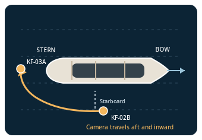

**Stern reveal.** The aft-quarter approach is planned to reveal the transom while respecting the stern's orientation. KF-03B identifies a subsequent aft camera position. This is a schematic—not a scale drawing or a verified 3D trajectory.

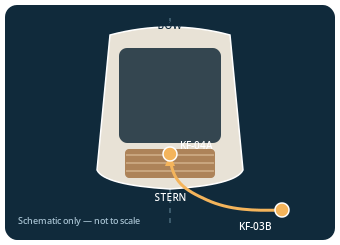

### The challenge: travel from exterior deck to interior saloon

An exterior-to-interior shot introduces another continuity risk: the AI may invent a doorway, move furniture, or change the room's layout. We planned the CAM-05 movement from the **aft cockpit through the open sliding doorway into the main saloon**, with KF-05A and KF-05B defining the intended progression.

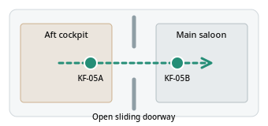

CAM-05's approved final decoded frame was then used as the conditioning reference for CAM-06, which continues inside the **same main-deck saloon**. Technical QA classified the CAM-05/CAM-06 opening-frame match as `VISUALLY_CONSISTENT_NONIDENTICAL`: room identity was retained, but the seam was **not pixel-identical** and remains an editorial continuity consideration.


### Camera Framing References

The planned geometry schematics map directly to governed keyframe master images and continuity anchors locked in the repository:

| Keyframe / Anchor | Shot Role | Description | Governed Asset Path |
| :--- | :--- | :--- | :--- |
| **`KF-02B`** | CAM-02 Tail | Parallel running starboard broadside anchor | [`KF-02B_master.png`](productions/YVP-ORIGINAL-001/assets/approved/keyframes/KF-02B_master.png) |
| **`KF-03A`** | CAM-03 Head | Aft-quarter approach opening anchor | [`KF-03A_master.png`](productions/YVP-ORIGINAL-001/assets/approved/keyframes/KF-03A_master.png) |
| **`KF-03B`** | CAM-03 Tail | Transom follow closing anchor | [`KF-03B_master.png`](productions/YVP-ORIGINAL-001/assets/approved/keyframes/KF-03B_master.png) |
| **`KF-05A`** | CAM-05 Head | Aft cockpit doorway approach anchor | [`KF-05A_master.png`](productions/YVP-ORIGINAL-001/assets/approved/keyframes/KF-05A_master.png) |
| **`KF-05B`** | CAM-05 Tail | Threshold sliding door sill plane anchor | [`KF-05B_master.png`](productions/YVP-ORIGINAL-001/assets/approved/keyframes/KF-05B_master.png) |
| **`CAM-05 F189`** | CAM-06 Head | Main-deck saloon continuation starting frame | [`CAM-05_take-001_final_frame.png`](productions/YVP-ORIGINAL-001/video/candidates/CAM-05/take-001/CAM-05_take-001_final_frame.png) |

### Our production method

1. **Identity lock:** Establish vessel proportions, hull and superstructure colors, glazing, deck arrangement, materials, and scene lighting before developing shot variants.
2. **Camera geometry:** Define the viewpoint, direction of travel, relative orientation, and intended framing for each shot using schematics and camera briefs.
3. **Keyframe production:** Prepare controlled visual anchors for openings, closings, and transitions; maintain a record of approved reference images and their roles.
4. **Image-to-video handoff:** Supply the video model with the appropriate reference frames, movement choreography, restrictions, and expected output settings rather than relying on generic prompts.
5. **Human visual acceptance:** Review candidate results for yacht identity, camera motion, architectural stability, and cinematic quality; approve or request a targeted revision.
6. **Technical intake and QA:** Preserve original candidates, record hashes and stream metadata, verify decoded frames, compare continuity anchors, and document outstanding risks.
7. **Editorial assembly:** Conform approved raw candidates to the intended timeline and combine them in a separate, authorized editing stage.

### Why the workflow is reusable

The workflow separates **creative decisions** (identity, framing, movement, visual approval) from **repeatable operations** (asset organization, manifests, hashes, frame extraction, QA, and production handoff). This supports a strategy for producing **100+ video requests** from a smaller, curated set of original reference assets, with shot-specific variations and review gates. The 100+ figure is a **scaling objective**, not a claim that 100 completed videos have already been produced.

Preparing geometry, reference images, and precise prompts in advance can reduce avoidable retries and AI-generation credit waste. It does **not guarantee** zero revisions, perfect geometric fidelity, or a particular credit saving. The benefit is clearer creative control, traceable decisions, and more targeted iteration when a candidate fails.

### Pilot coverage and optional brand ending

The original pilot has a **locked 10-second / 240-frame / 24-fps** six-camera plan: exterior bow and starboard views, aft reveal, aft-deck progression, main-saloon entry, and main-saloon continuation. The **CAM-07 SOTA AI card reveal** is a separately planned optional branded extension and must not be represented as part of the original 240-frame master unless an extended cut is explicitly approved and assembled.

> **Production evidence:** These diagrams describe the planned camera geometry. Actual video quality, seamlessness, and final delivery should be assessed from the linked pilot and the production QA records—not inferred from the schematics alone.

---

<p align="center">
  <b>Yacht Video Production (YVP) System</b><br/>
  <i>Engineered for cinematic excellence, structural fidelity, and repeatable generative filmmaking.</i>
</p>
