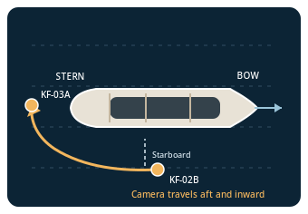
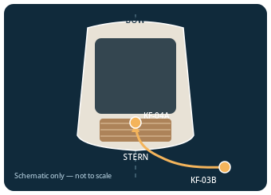
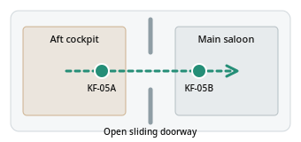

## Production Journey — From Yacht Identity to Cinematic Camera Continuity

The **YVP-ORIGINAL-001 / AURELIA 42** pilot was developed as a reusable, governed image-to-video production workflow—not simply a sequence of unrelated AI-generated clips. The pilot demonstrates how a small set of controlled reference images, vessel-identity constraints, camera-path diagrams, shot-specific keyframes, human visual review, and technical validation can support consistent cinematic yacht coverage.

### The challenge: move around one recognizable yacht

A major challenge in AI yacht filmmaking is maintaining **the same vessel** while changing viewpoint. An orbit from starboard toward the stern must preserve the bow/stern orientation, superstructure, glazing, deck tiers, and aft architecture. If each frame is generated independently, the yacht can subtly change shape between shots. We therefore planned camera positions and transitions *before* generating animation candidates, using geometry diagrams as creative constraints rather than pretending they are surveyed CAD measurements.

**Starboard-to-aft camera transition.** The camera travels aft and inward from the starboard-side view toward the stern. The orange path illustrates the intended camera movement, while KF-02B and KF-03A identify the relevant planned framing positions.

**Stern reveal.** The aft-quarter approach is planned to reveal the transom while respecting the stern's orientation. KF-03B identifies a subsequent aft camera position. This is a schematic—not a scale drawing or a verified 3D trajectory.

### The challenge: travel from exterior deck to interior saloon

An exterior-to-interior shot introduces another continuity risk: the AI may invent a doorway, move furniture, or change the room's layout. We planned the CAM-05 movement from the **aft cockpit through the open sliding doorway into the main saloon**, with KF-05A and KF-05B defining the intended progression.

CAM-05's approved final decoded frame was then used as the conditioning reference for CAM-06, which continues inside the **same main-deck saloon**. Technical QA classified the CAM-05/CAM-06 opening-frame match as `VISUALLY_CONSISTENT_NONIDENTICAL`: room identity was retained, but the seam was **not pixel-identical** and remains an editorial continuity consideration.

### Our production method

1. **Identity lock:** Establish vessel proportions, hull and superstructure colors, glazing, deck arrangement, materials, and scene lighting before developing shot variants.
2. **Camera geometry:** Define the viewpoint, direction of travel, relative orientation, and intended framing for each shot using schematics and camera briefs.
3. **Keyframe production:** Prepare controlled visual anchors for openings, closings, and transitions; maintain a record of approved reference images and their roles.
4. **Image-to-video handoff:** Supply the video model with the appropriate reference frames, movement choreography, restrictions, and expected output settings rather than relying on generic prompts.
5. **Human visual acceptance:** Review candidate results for yacht identity, camera motion, architectural stability, and cinematic quality; approve or request a targeted revision.
6. **Technical intake and QA:** Preserve original candidates, record hashes and stream metadata, verify decoded frames, compare continuity anchors, and document outstanding risks.
7. **Editorial assembly:** Conform approved raw candidates to the intended timeline and combine them in a separate, authorized editing stage.

### Why the workflow is reusable

The workflow separates **creative decisions** (identity, framing, movement, visual approval) from **repeatable operations** (asset organization, manifests, hashes, frame extraction, QA, and production handoff). This supports a strategy for producing **100+ video requests** from a smaller, curated set of original reference assets, with shot-specific variations and review gates. The 100+ figure is a **scaling objective**, not a claim that 100 completed videos have already been produced.

Preparing geometry, reference images, and precise prompts in advance can reduce avoidable retries and AI-generation credit waste. It does **not guarantee** zero revisions, perfect geometric fidelity, or a particular credit saving. The benefit is clearer creative control, traceable decisions, and more targeted iteration when a candidate fails.

### Pilot coverage and optional brand ending

The original pilot has a **locked 10-second / 240-frame / 24-fps** six-camera plan: exterior bow and starboard views, aft reveal, aft-deck progression, main-saloon entry, and main-saloon continuation. The **CAM-07 SOTA AI card reveal** is a separately planned optional branded extension and must not be represented as part of the original 240-frame master unless an extended cut is explicitly approved and assembled.

> **Production evidence:** These diagrams describe the planned camera geometry. Actual video quality, seamlessness, and final delivery should be assessed from the linked pilot and the production QA records—not inferred from the schematics alone.
